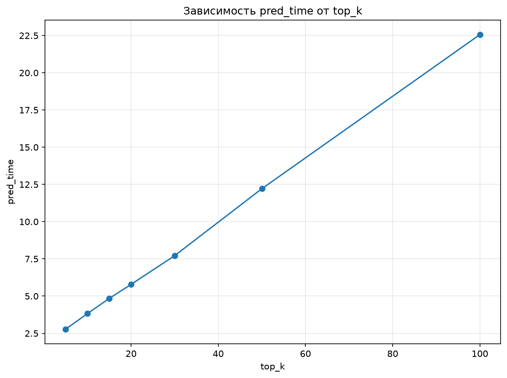
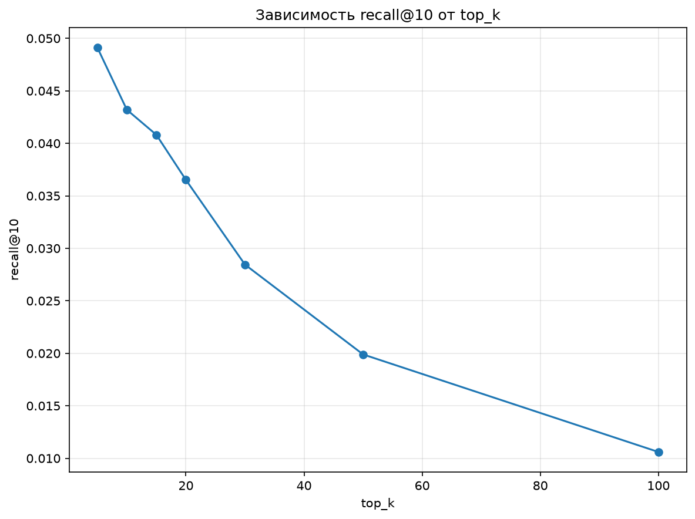
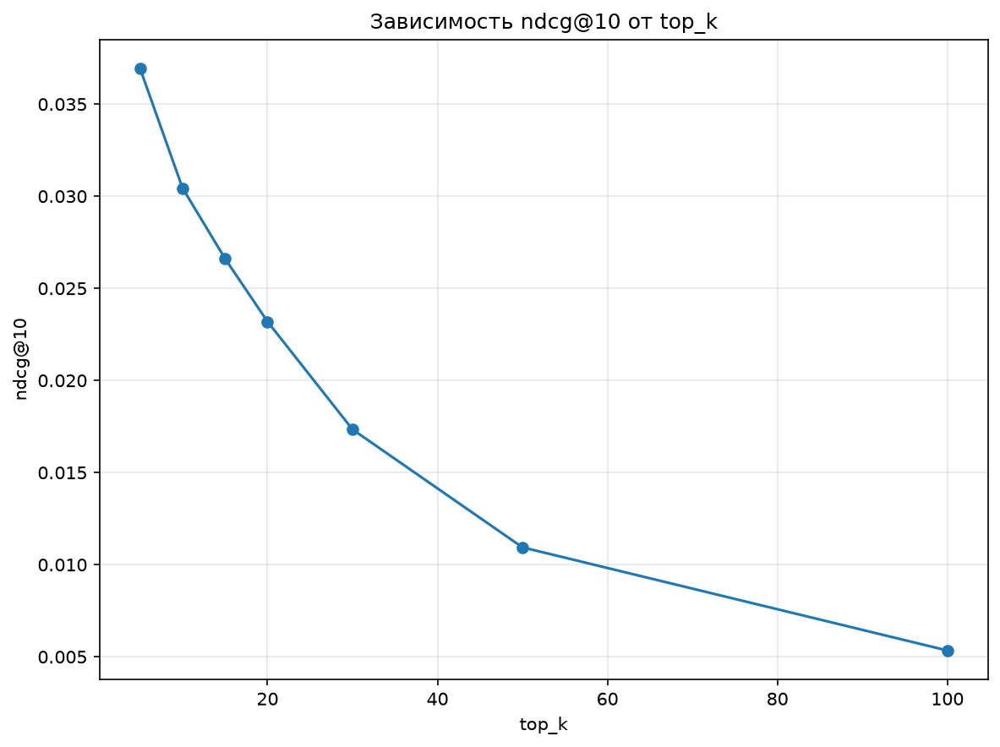
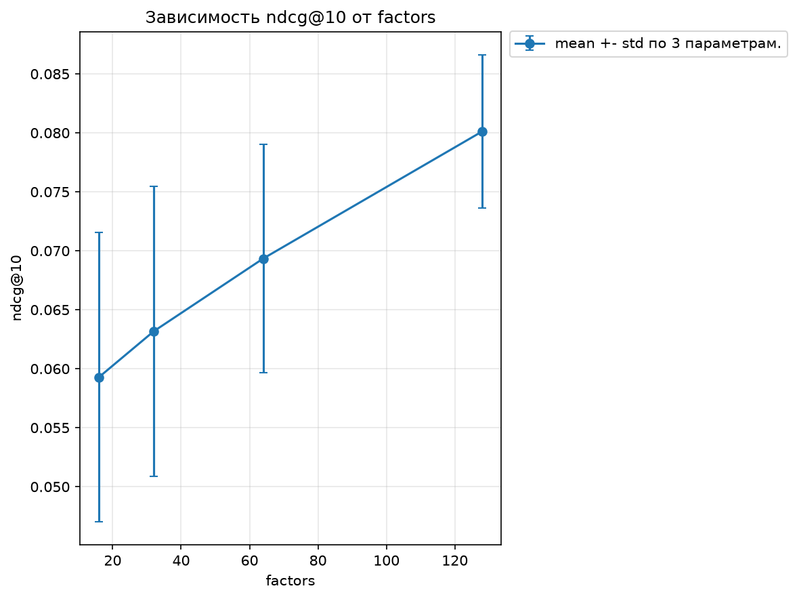
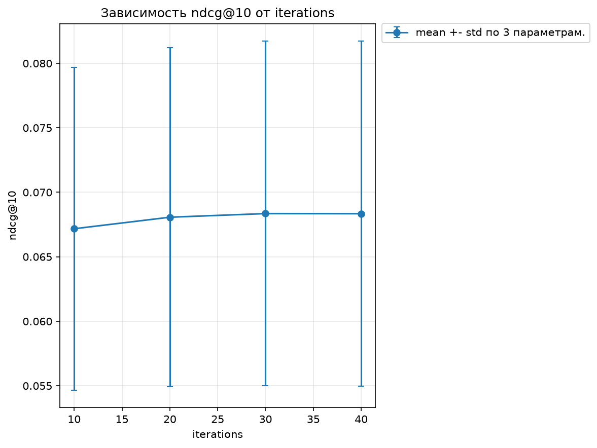
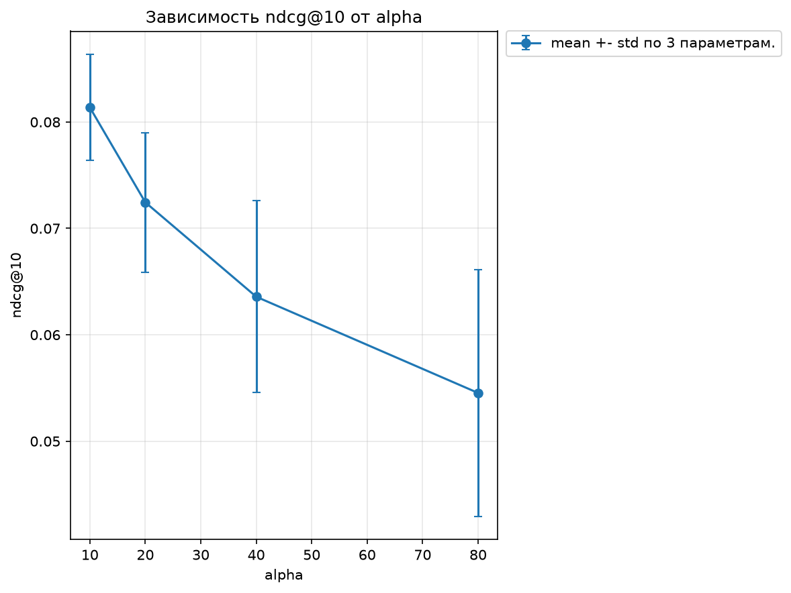
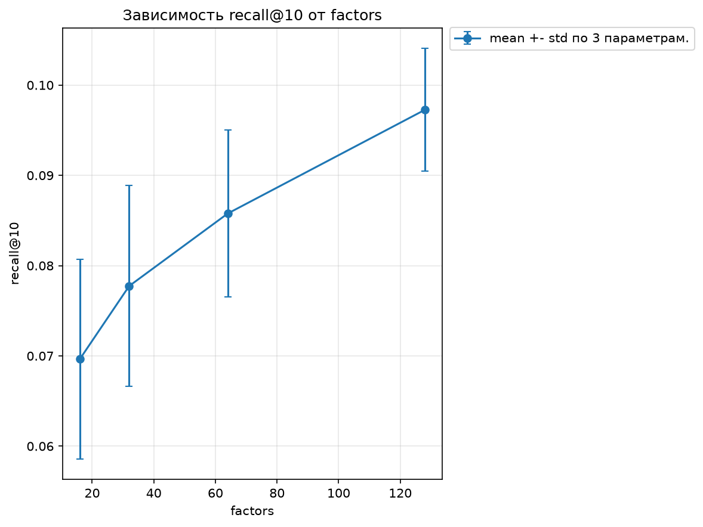
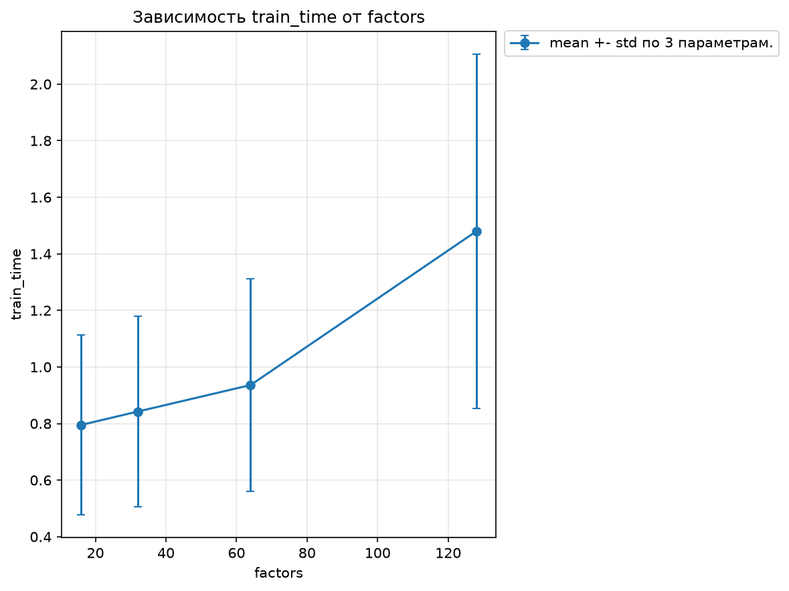
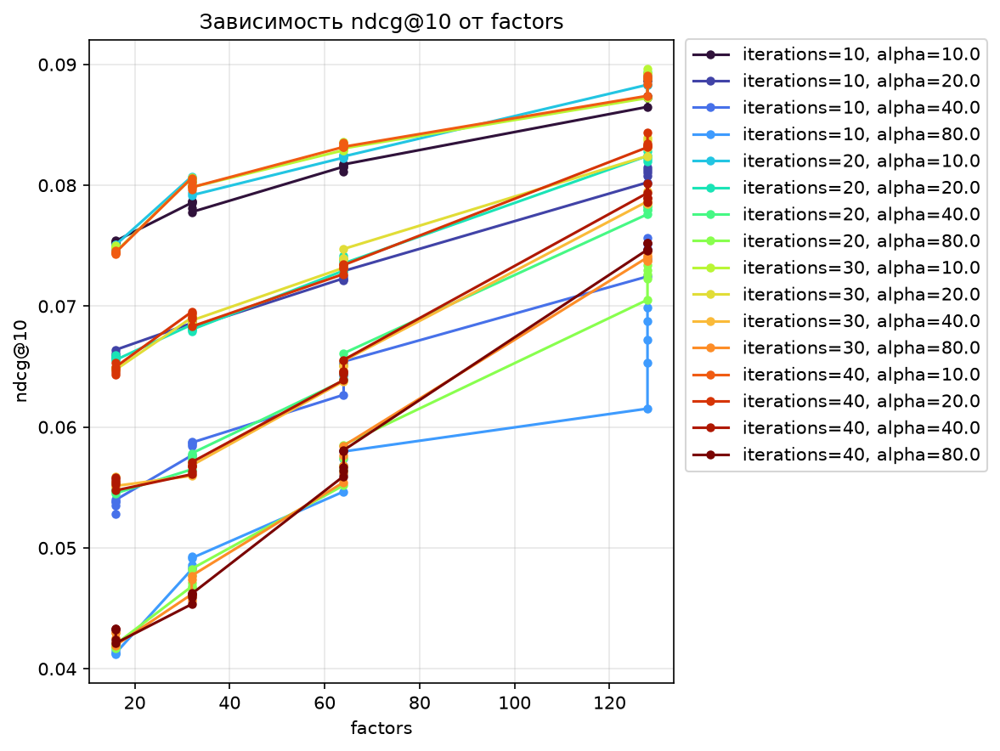

# Бенчмарк алгоритмов коллаборативной фильтрации на MovieLens-32M

Репозиторий с кодом подготовки данных и сравнительных замеров memory-based и model-based алгоритмов коллаборативной фильтрации. Содержит единый интерфейс моделей, метрики качества и ресурсов, процедуру подбора гиперпараметров и результаты тестового запуска на подвыборке 1M оценок.


## Содержание
- [О проекте](#бенчмарк-алгоритмов-коллаборативной-фильтрации-на-movielens-32m)
- [Результаты](#результаты)
- [Функциональность](#функциональность)
- [Установка и запуск](#установка-и-запуск)
- [Алгоритмы](#алгоритмы)
- [Метрики](#метрики)
- [Графики](#графики)
- [Структура проекта](#структура-проекта)

## Результаты

Тестовый запуск на подвыборке 1M оценок (разбиение 70/10/20: 700135 train / 99921 val / 199960 test, 6373 пользователя, 20440 фильмов в train, плотность 0.54%). Подбор гиперпараметров выполнен на `val`, финальные модели обучены на `train + val` и оценены на `test`. Все замеры - среднее по `n_runs=3`, обучение на CPU.

| Алгоритм | Параметры | train_time, с | pred_time, с | train_mem_delta, МБ | train_mem_peak, МБ | pred_mem_delta, МБ | pred_mem_peak, МБ | Recall@10 | NDCG@10 |
|---|---|---|---|---|---|---|---|---|---|
| UserBasedCF | top_k=5 | 2.648 | 2.903 | 1261.25 | 2518.90 | 551.88 | 2519.11 | 0.0407 | 0.0438 |
| ImplicitALS | factors=128, iterations=30, regularization=0.5, alpha=10 | 1.998 | 1.669 | 79.56 | 1388.42 | 0.02 | 1331.70 | 0.0878 | 0.1120 |

Ключевые выводы:

- `ImplicitALS` превосходит `UserBasedCF` по всем метрикам: по `NDCG@10` (в 2.56 раза), `Recall@10` (в 2.16 раза), скорости обучения и выдачи рекомендаций, а также потреблению памяти.
- Для `UserBasedCF` оптимум - `top_k=5`: увеличение `top_k` монотонно ухудшает обе метрики и линейно увеличивает время предсказания.
- Для `ImplicitALS` обе метрики качества растут с увеличением `factors`, слабо зависят от `regularization` и монотонно убывают с ростом `alpha` (оптимум `alpha=10`).

## Функциональность

- Загрузка MovieLens-32M и формирование подвыборок 1M / 10M / 32M по пользователям.
- Разбиение train/test по времени в пропорции 70/10/20 для каждого пользователя.
- Описательная статистика подвыборок: число пользователей/фильмов, плотность, распределение оценок, память DataFrame.
- Единый абстрактный интерфейс моделей (`BaseRecommender`) с методами `fit`, `recommend`, `get_pred_matrix`, `info`, `label`.
- Реализации memory-based `UserBasedCF` и model-based `ImplicitALS` в одном API.
- Замер времени (`timer`) и пикового прироста RSS (`memory_usage`) через контекстные менеджеры.
- Единый расчет метрик качества `Recall@10` и `NDCG@10` через `RecsMetrics` (по списку рекомендаций).
- Подбор гиперпараметров.
- Адаптивное построение графиков зависимостей метрик от гиперпараметров.

## Установка и запуск

1. Клонирование репозитория
```bash
git clone https://github.com/AlexanderSh11/recsys-benchmark.git
cd recsys-benchmark
```
2. Создание и активация виртуального окружения
```bash
conda env create -f environment.yml
conda activate recsys-benchmark
```
3. Загрузка датасета
```bash
wget https://files.grouplens.org/datasets/movielens/ml-32m.zip
unzip ml-32m.zip -d data/raw/
```
4. Подготовка данных (подвыборки 1M / 10M / 32M, сплит train/test) с помощью функций из utils/data_load.py

5. Запуск бенчмарка в run_benchmark.ipynb

## Алгоритмы

### 1. UserBasedCF (memory-based)

#### Класс: UserBasedCF в algorithms/baseline.py

#### Принцип работы:

Строится плотная матрица оценок [n_users, n_items]. Для всех пар пользователей вычисляется косинусная схожесть через sklearn.metrics.pairwise_distances(metric="cosine"). Предсказание для пары «пользователь-объект» равно взвешенному среднему нормализованных оценок top_k наиболее похожих пользователей. Подробнее про реализацию - в [репозитории веб-приложения](https://github.com/AlexanderSh11/films_app#2-user-based-%D0%BA%D0%BE%D0%BB%D0%BB%D0%B0%D0%B1%D0%BE%D1%80%D0%B0%D1%82%D0%B8%D0%B2%D0%BD%D0%B0%D1%8F-%D1%84%D0%B8%D0%BB%D1%8C%D1%82%D1%80%D0%B0%D1%86%D0%B8%D1%8F).

#### Гиперпараметр:

- top_k - число ближайших соседей при предсказании.

### 2. ImplicitALS (model-based)

#### Класс: ImplicitALS в algorithms/implicit_als.py

#### Принцип работы:

Оценки в train трактуются как веса взаимодействий и умножаются на alpha (параметр уверенности), после чего строится разреженная матрица csr_matrix размера [n_users, n_items]. Обучение с помощью функции implicit.als.AlternatingLeastSquares.fit на разреженной матрице взаимодействий [n_users, n_items] по положительным оценкам (rating >= 3.5). Рекомендации возвращаются через model.recommend(...).

#### Гиперпараметры:

- factors - размерность пространства скрытых признаков;

- iterations - число итераций ALS;

- regularization - коэффициент L2-регуляризации;

- alpha - коэффициент уверенности для неявной обратной связи.

## Метрики

### Качество:

- Recall@10 - доля релевантных объектов (rating >= 3.5) в топ-10, усредненная по пользователям с хотя бы одним релевантным объектом в тесте.

- NDCG@10 - нормированная дисконтированная совокупная выгода с учетом порядка и оценок (метрика качества ранжирования).

### Вычислительные ресурсы:

- train_time - время model.fit, через utils.timer.timer.

- pred_time - время model.recommend, через utils.timer.timer.

- train_mem_delta - пиковый прирост RSS при обучении, через utils.memory_usage.memory_usage.

- pred_mem_delta - пиковый прирост RSS при выдаче рекомендаций, через utils.memory_usage.memory_usage.

## Графики

### UserBasedCF

<div align="center">
  <table>
    <tr>
      <td align="center">
        
        <br/>
        <b>Время выдачи рекомендаций</b>
      </td>
      <td align="center">
        
        <br/>
        <b>Recall@10</b>
      </td>
      <td align="center">
        
        <br/>
        <b>NDCG@10</b>
      </td>
    </tr>
  </table>
</div>

### ImplicitALS - зависимость метрик от гиперпараметров (mean +- std по остальным параметрам)

<div align="center">
  <table>
    <tr>
      <td align="center">
        
        <br/>
        <b>NDCG@10 от factors</b>
      </td>
      <td align="center">
        
        <br/>
        <b>NDCG@10 от iterations</b>
      </td>
      <td align="center">
        
        <br/>
        <b>NDCG@10 от alpha</b>
      </td>
    </tr>
    <tr>
      <td align="center">
        
        <br/>
        <b>Recall@10 от factors</b>
      </td>
      <td align="center">
        
        <br/>
        <b>train_time от factors</b>
      </td>
      <td align="center">
        
        <br/>
        <b>NDCG@10 от factors</b>
      </td>
    </tr>
  </table>
</div>

> Полные результаты подбора (зависимости от `factors`, `iterations`, `regularization`, `alpha` для `train_time`, `Recall@10`, `NDCG@10`) - в папке [`benchmarks/graphs/`](benchmarks/graphs/).

## Структура проекта
```
recsys-benchmark/
├── algorithms/ # Модели
│ ├── base.py # Абстрактный интерфейс BaseRecommender
│ ├── baseline.py # UserBasedCF
│ └── implicit_als.py # ImplicitALS
├── benchmarks/ # Скрипты подготовки данных и замеров
│ ├── graphs/ # Графики зависимостей
│ ├── run_benchmark.ipynb # Ноутбук с тестовым запуском
│ └── benchmark_func.py # run_benchmark, params_search, show_graph
├── data/ # Данные в csv, pkl
│ ├── processed/
│ └── raw/
├── metrics/ # Метрики
│ └── metrics.py # RecsMetrics
├── utils/ # Вспомогательные модули
│ ├── data_load.py # load_dataset, make_subset, split_train_test_by_time
│ ├── data_stats.py # Описательная статистика подвыборок
│ ├── timer.py # Контекстный менеджер timer
│ └── memory_usage.py # Контекстный менеджер memory_usage
├── environment.yml # Зависимости проекта
└── README.md
```
